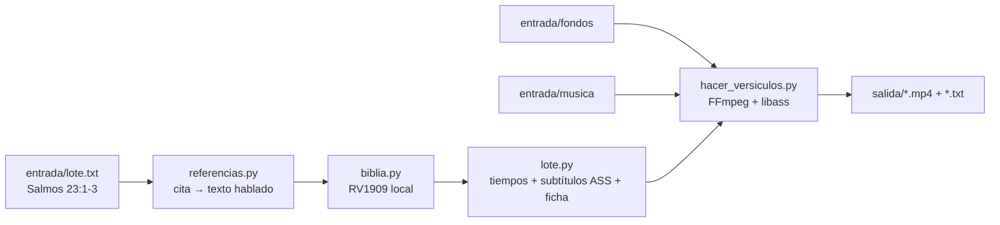

<div align="center">

# 📖 Shorts de versículos

**Fábrica en serie de YouTube Shorts cristianos: escribes la cita y sale el vídeo vertical con el versículo, fondo, música, subtítulos y la ficha para subirlo.**

Incluye además un modo **clipping**: convierte prédicas largas en clips verticales subtitulados para campañas que pagan por vistas.

[](LICENSE)
[](requirements.txt)
[](scripts)
[](https://keizactech.com/docs)

</div>

---

## ✨ Qué hace

**A. Shorts de versículos**
- Escribes `Salmos 23:1-3` y el texto sale solo de la **Reina-Valera 1909** (dominio público).
- En pantalla se lee *"Salmos capítulo 23, versículo 1"*, con un versículo por pantalla.
- Fondo de paisaje y música elegidos al azar de tus carpetas, recortados a **1080×1920**.
- Por cada Short genera un `.txt` con **título, descripción, hashtags y la atribución de la música**, listo para copiar.

**B. Clipping**
- Le das una prédica larga. Transcribe con **faster-whisper** en la CPU, sin pagar ninguna API.
- Corta clips verticales con subtítulos y, si detecta una cita bíblica hablada, pone un **cartel con la cita**.

## 🧠 Cómo funciona



| Archivo | Qué hace |
|---|---|
| `scripts/referencias.py` | Entiende "Salmos 3:4", "Juan 3 16" o "Juan capítulo 3 versículo 5" |
| `scripts/biblia.py` | Prepara la RV1909 de eBible.org: modernización mínima, sin títulos ni "Selah" |
| `scripts/lote.py` | Calcula tiempos (~2,4 palabras/s), genera los subtítulos y la ficha. Es puro y tiene tests |
| `scripts/hacer_versiculos.py` | Monta el Short con FFmpeg |
| `scripts/hacer_clipping.py` | Transcribe y corta los clips |

## 🚀 Arranque rápido

**Necesitas:** Python 3.10+, FFmpeg con libass.

```bash
git clone https://github.com/RosaritoRD/shorts-versiculos.git
cd shorts-versiculos
python3 -m venv .venv && .venv/bin/pip install -r requirements.txt
python3 scripts/biblia.py preparar      # crea biblia/rv1909.json
./probar.sh                             # prueba completa con material sintético
```

Luego:
1. Fondos (vídeos de Pexels o Pixabay) en `entrada/fondos/`.
2. Música de la Biblioteca de audio de YouTube en `entrada/musica/`. Si la pista pide atribución, pon un `.txt` con el mismo nombre.
3. Escribe tus citas en `entrada/lote.txt`, separadas por `---`.
4. `./versiculos.sh`, y tus Shorts aparecen en `salida/`.

Guía completa paso a paso: **[COMO-USAR.md](COMO-USAR.md)**.

## ⚠️ Derechos
- Usa solo fondos con licencia comercial (Pexels, Pixabay) y música de la Biblioteca de audio de YouTube.
- En **clipping**, corta solo prédicas de campañas que te autoricen a hacerlo.
- En **Job 39–41** la RV1909 numera distinto que las Biblias modernas: pon el texto a mano con `Cita | texto`.

## 🤖 Con Claude Code o Codex
El repo trae `CLAUDE.md` con todo el contexto. Abre la carpeta con `claude` o `codex` y pídele, por ejemplo: *"Añade otra traducción de la Biblia"* o *"Haz que el título lleve el tema del versículo"*.

## 💸 Ahorro y mejoras
Ver **[AHORRO-Y-MEJORAS.md](AHORRO-Y-MEJORAS.md)**.

## 📚 Más
- Para producir oraciones completas (largos + Shorts) con IA: **[Oraflow](https://github.com/RosaritoRD/oraflow)**
- Para la voz local gratis: **[voz-local](https://github.com/RosaritoRD/voz-local)**
- 📖 Guías: **[keizactech.com/docs](https://keizactech.com/docs)**

## 📄 Licencia
Código: MIT. Texto bíblico: Reina-Valera 1909, dominio público (eBible.org).
