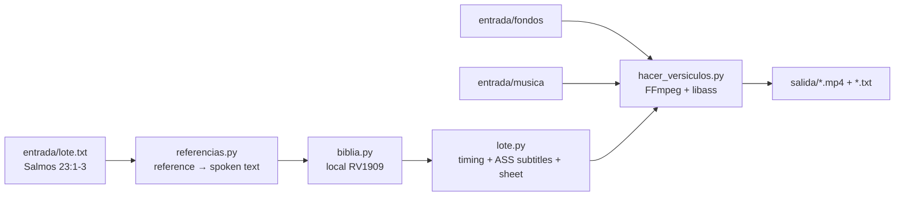

<div align="center">

# 📖 Bible Verse Shorts

**A batch factory for Christian YouTube Shorts in Spanish: type the Bible reference and out comes a vertical video with the verse, background, music, subtitles and an upload sheet.**

It also includes a **clipping** mode: turns long sermons into subtitled vertical clips for campaigns that pay per view.

[](LICENSE)
[](requirements.txt)
[](scripts)
[](https://keizactech.com/docs)

</div>

---

## ✨ What it does

**A. Verse Shorts**
- You type `Salmos 23:1-3` and the text comes straight from the **Reina-Valera 1909** Spanish Bible (public domain).
- On screen it reads *"Salmos capítulo 23, versículo 1"*, one verse per screen.
- A landscape background and music picked at random from your folders, cropped to **1080×1920**.
- For every Short it writes a `.txt` with the **title, description, hashtags and music attribution**, ready to copy.

**B. Clipping**
- Give it a long sermon. It transcribes with **faster-whisper** on the CPU, without paying for any API.
- It cuts subtitled vertical clips and, when it detects a spoken Bible reference, adds a **title card with the reference**.

## 🧠 How it works



| File | What it does |
|---|---|
| `scripts/referencias.py` | Understands "Salmos 3:4", "Juan 3 16" or "Juan capítulo 3 versículo 5" |
| `scripts/biblia.py` | Prepares the RV1909 from eBible.org: minimal modernization, no headings or "Selah" |
| `scripts/lote.py` | Computes timing (~2.4 words/s), builds the subtitles and the sheet. Pure and tested |
| `scripts/hacer_versiculos.py` | Assembles the Short with FFmpeg |
| `scripts/hacer_clipping.py` | Transcribes and cuts the clips |

## 🚀 Quick start

**You need:** Python 3.10+ and FFmpeg with libass.

```bash
git clone https://github.com/RosaritoRD/shorts-versiculos.git
cd shorts-versiculos
python3 -m venv .venv && .venv/bin/pip install -r requirements.txt
python3 scripts/biblia.py preparar      # creates biblia/rv1909.json
./probar.sh                             # full test run with synthetic material
```

Then:
1. Backgrounds (videos from Pexels or Pixabay) go in `entrada/fondos/`.
2. Music from the YouTube Audio Library goes in `entrada/musica/`. If a track requires attribution, add a `.txt` with the same name.
3. Write your references in `entrada/lote.txt`, separated by `---`.
4. Run `./versiculos.sh`, and your Shorts show up in `salida/`.

Full step-by-step guide: **[HOW-TO-USE.md](HOW-TO-USE.md)**.

## ⚠️ Rights
- Only use backgrounds with a commercial license (Pexels, Pixabay) and music from the YouTube Audio Library.
- In **clipping** mode, only cut sermons from campaigns that authorize you to do so.
- In **Job 39–41** the RV1909 numbers verses differently from modern Bibles: enter the text by hand with `Reference | text`.

## 🤖 With Claude Code or Codex
The repo ships a `CLAUDE.md` with all the context. Open the folder with `claude` or `codex` and ask, for example: *"Add another Bible translation"* or *"Put the verse's theme in the title."*

## 💸 Savings and tips
See **[SAVINGS-AND-TIPS.md](SAVINGS-AND-TIPS.md)**.

## 🤝 Contributing
Issues and PRs are welcome — look for the [`good first issue`](https://github.com/RosaritoRD/shorts-versiculos/labels/good%20first%20issue) label and read [CONTRIBUTING.md](CONTRIBUTING.md).

## 📚 More
- To produce full prayers (long videos + Shorts) with AI: **[Oraflow](https://github.com/RosaritoRD/oraflow)**
- For free local voice: **[voz-local](https://github.com/RosaritoRD/voz-local)**
- 📖 Guides: **[keizactech.com/docs](https://keizactech.com/docs)**

## 📄 License
Code: MIT. Bible text: Reina-Valera 1909, public domain (eBible.org).
